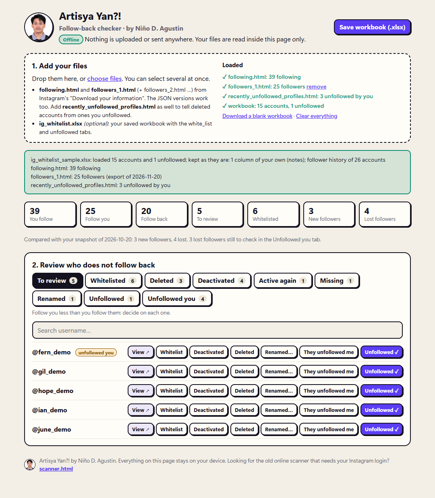
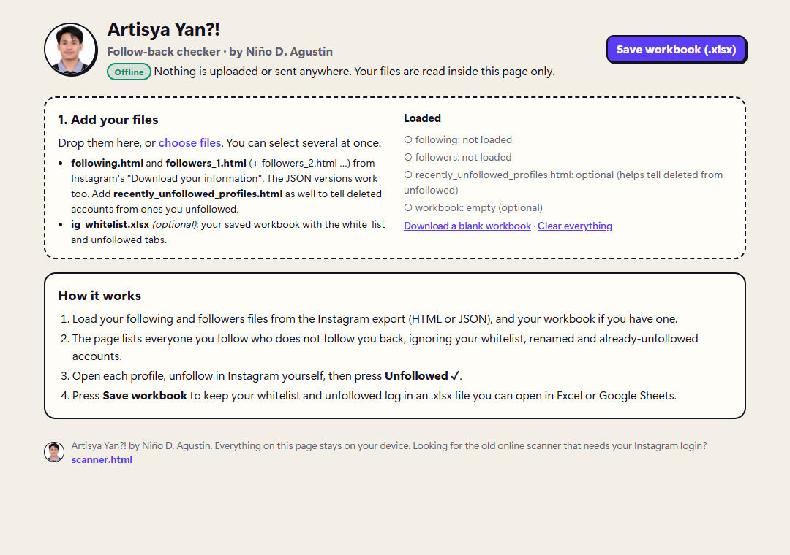
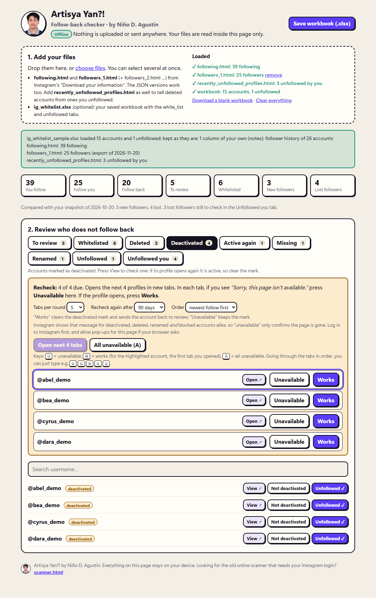
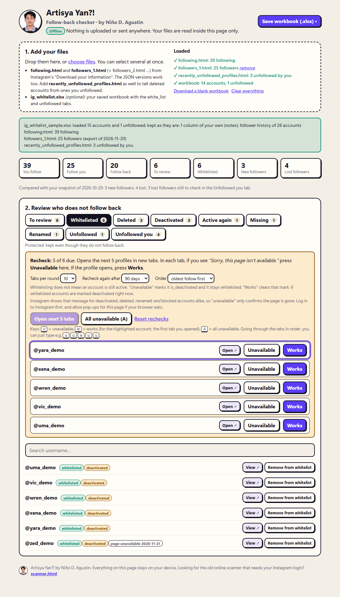
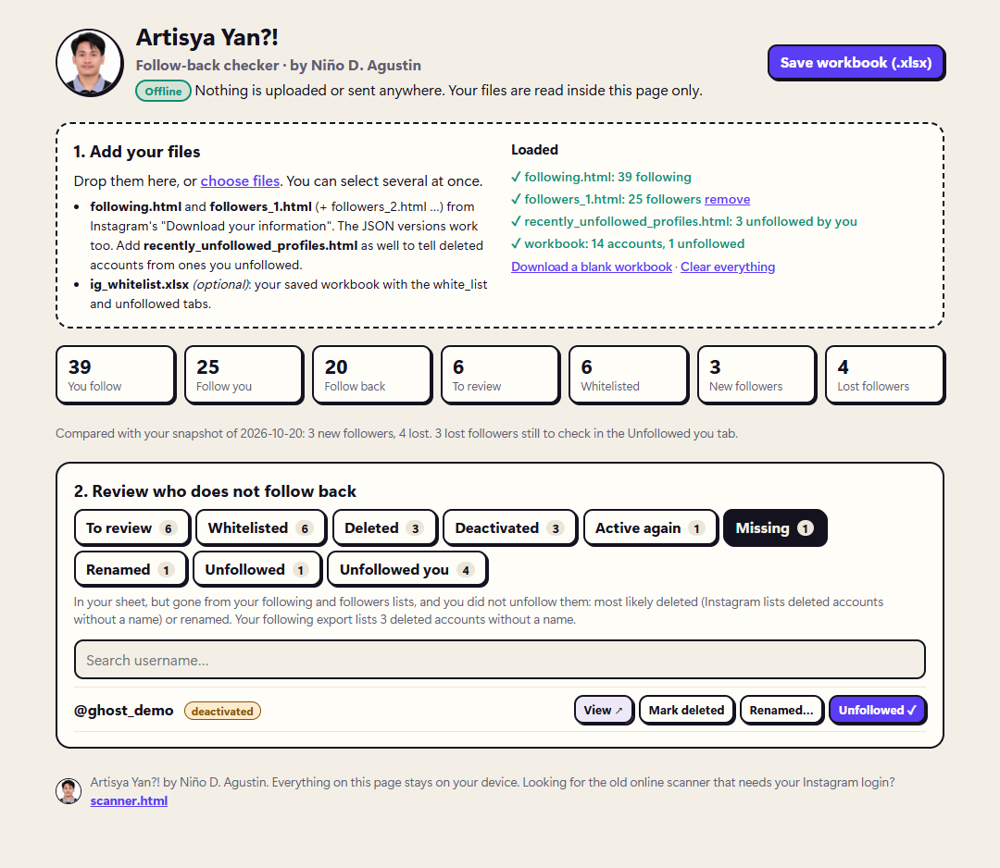
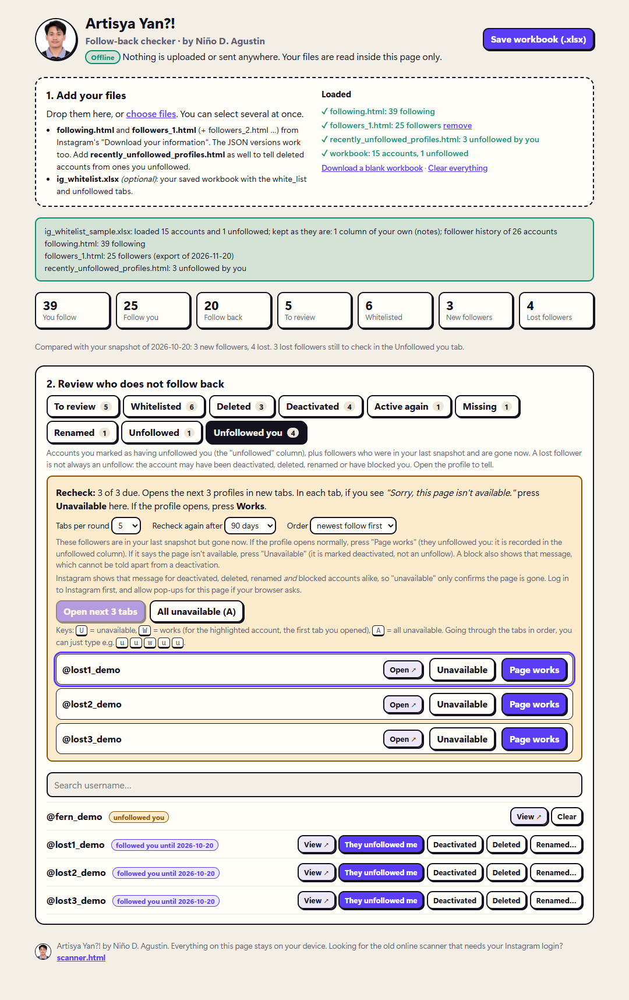

<p align="center">
  
</p>

# Artisya Yan?!

**An offline follow-back checker for Instagram.** by [Niño D. Agustin](#-about)

Find out who you follow on Instagram that doesn't follow you back, and keep your whitelist and notes in a spreadsheet.

**It runs offline.** You give it the files from Instagram's *Download your information*, and it never talks to Instagram or
anything else. Nothing is uploaded; your files are read inside the page only.

### 👉 [Open the checker](https://enclaveagustin.github.io/artisya-yan/)

*(You can also download this repository and double-click `docs/index.html`; it works straight from your disk.)*

<p align="center">
  
</p>

---

## ✅ Quick start

1. [Download your Instagram data](#1-download-your-instagram-data) (HTML format).
2. Open the [checker](https://enclaveagustin.github.io/artisya-yan/).
3. Drop in the **ZIP** exactly as Instagram gave it (no unzipping), plus your Excel workbook if you have one (use the [sample workbook](#3-upload-the-excel-workbook) to try it).
4. Review the list, **View** each profile, unfollow on Instagram yourself, press **Unfollowed ✓**.
5. **Save workbook (.xlsx)** and keep that file. It is your database. Next time, load a newer export with it and the page shows [who unfollowed you](#6-find-out-who-unfollowed-you).

> **Want to try it first?** Everything in [`samples/`](samples) is made up. Upload the files there and compare with the
> [expected result](#-try-it-with-the-sample-files).

---

## 📖 Step-by-step guide

### 1. Download your Instagram data

1. On Instagram open **Settings → Accounts Center → Your information and permissions → Download your information**
   *(menu names change slightly from time to time)*.
2. Choose **Download or transfer information**, pick your Instagram account, then **Some of your information**.
3. Tick **Followers and following** only.
4. Choose **Download to device**, date range **All time**, format **HTML**, and start the export.
5. Instagram emails you when it is ready (minutes to a day or two). Download the ZIP. **Keep it zipped:** the checker opens the ZIP itself and finds the lists inside.

Inside it, in `connections/followers_and_following/`, these are the files the checker uses:

| File | Needed? | What it is |
|---|---|---|
| `following.html` | **yes** | the accounts you follow |
| `followers_1.html` (`followers_2.html` …) | **yes** | the accounts that follow you (several files if you have many) |
| `recently_unfollowed_profiles.html` | optional | accounts you unfollowed; stops them being mistaken for deleted ones |
| the other files (close friends, blocked, favourites …) | no | recognised and ignored |

The JSON versions work too. If you prefer, you can still unzip it and drop those files in one by one. Only the `.zip` of a
"Followers and following" export is practical to drop in: a full export with photos and messages can be several GB, and the page
refuses a ZIP over 1 GB (it would freeze the tab), so request only **Followers and following**.

### 2. Open the checker

Open **<https://enclaveagustin.github.io/artisya-yan/>**. You can also download this repository and double-click
`docs/index.html` to use it straight from your disk. It works the same, with no internet needed.

<p align="center">
  
</p>

### 3. Upload the Excel workbook

The workbook is your database: your whitelist, your notes and your unfollowed log live in it.

1. **Download the sample workbook:** open [`samples/ig_whitelist_sample.xlsx`](samples/ig_whitelist_sample.xlsx) on GitHub and press
   the **Download raw file** button (the download icon, top right of the file view).
2. **Upload it:** drag the file onto the checker, or press **choose files** and select it. Select your Instagram files in the same go.
3. The *Loaded* list ticks each file and shows how many accounts it found.

To use it for real, replace the sample with **your own** `ig_whitelist.xlsx`. Starting from scratch? Use the blank
[`templates/ig_whitelist_template.xlsx`](templates/ig_whitelist_template.xlsx), or press **Download a blank workbook** on the page.

**The workbook format** (three tabs):

| Tab | Columns | Notes |
|---|---|---|
| `white_list` | `username` · `profile_link` · `is_whitelisted` · `is_deactivated` · `new_username` · `unfollowed` · `is_deleted` · `last_checked` · `check_result` | one row per account you keep notes on |
| `new_followingxfollowers` | same columns | who does not follow you back; rewritten every time you save |
| `unfollowed` | `username` · `profile_link` · `unfollowed_on` | your log of accounts you unfollowed |
| `followers_snapshot` | `username` · `profile_link` · `first_seen` · `last_seen` | who has followed you and in which exports; the proof behind [who unfollowed you](#6-find-out-who-unfollowed-you). Written for you on every save |

- A flag column holds `y` (also `yes`, `true`, `1`, `x`) or stays empty. Upper or lower case, both fine.
- `new_username`: the account's new handle if it was renamed. If it follows you under the new name it is not a non-follower.
- `unfollowed`: marks an account that is proven to have unfollowed **you** (just for tracking).
- `last_checked` / `check_result`: filled in by the [recheck](#5-recheck-deactivated-accounts-and-whitelisted-ones) (the date you opened the profile, and `unavailable` or `works`). Older workbooks without these columns work too; they are added the first time you save.
- Columns are found by their header name, so their order does not matter.
- **Your workbook stays yours.** Columns of your own (a `notes` column, say) and any other sheets are kept when you save, and your column order and row order are not changed. New accounts are added at the end. The page tells you what it kept when you load the file. (Formulas, dates, colours and other formatting are not preserved; the values are.)

### 4. Review who doesn't follow back

<p align="center">
  
</p>

The page lists everyone you follow who does not follow you back, minus accounts you already sorted out. Each tab is a group:

| Tab | What is in it |
|---|---|
| **To review** | not following you back and not in any other group: decide on each one |
| **Whitelisted** | protected: kept even though they do not follow back |
| **Deleted** | Instagram lists them as `__deleted__…` (no name), or you marked `is_deleted` |
| **Deactivated** | marked `is_deactivated` in your sheet |
| **Active again** | marked deactivated or deleted, **but they follow you now**. A deactivated account cannot be a follower, so it is back (or the mark was a mistake) |
| **Missing** | in your sheet but gone from both lists, and you did not unfollow them: most likely deleted or renamed |
| **Renamed** | follow you under a new username (`new_username`) |
| **Unfollowed** | your log of accounts you unfollowed |
| **Unfollowed you** | accounts you marked as having unfollowed you, plus followers who were in your last snapshot and are gone now ([how](#6-find-out-who-unfollowed-you)) |

On each row: **View ↗** opens the profile in a new tab. Then use the buttons: **Whitelist**, **Deactivated**, **Deleted**,
**Renamed…**, **They unfollowed me**, or **Unfollowed ✓** once you have unfollowed them on Instagram. The page cannot
unfollow for you. That is on purpose.

### 5. Recheck deactivated accounts (and whitelisted ones)

An account can be deactivated and still be whitelisted: being whitelisted says nothing about whether it is still there.
The **recheck** works on the **Deactivated** tab and on the **Whitelisted** tab.

<p align="center">
  
</p>

1. Press **Open next 5 tabs**. Five Instagram profiles open in new tabs (log in to Instagram first; allow pop-ups for the
   page if your browser asks).
2. In each tab, look at the page. If you see:

   > Sorry, this page isn't available.
   > The link you followed may be broken, or the page may have been removed.

   press **Unavailable** for that account in the checker. If the profile opens normally, press **Works**.
3. **Unavailable** marks the account `is_deactivated` (a whitelisted account stays whitelisted and gets both marks).
   **Works** clears the deactivated mark; on the Deactivated tab the account goes back to review.
4. Repeat. Each round opens the next batch; **Reset rechecks** starts over.

**Go faster:**

| Setting / key | What it does |
|---|---|
| **Tabs per round** (5, 10 or 20) | how many profiles open at once (bigger rounds need pop-ups allowed) |
| **Recheck again after** (never, 30, 90 or 180 days) | an account you checked recently is skipped; after this many days it is due again. Default 90 days |
| **Order** | newest follow first (Instagram's order), oldest follow first, or A to Z |
| <kbd>U</kbd> / <kbd>W</kbd> | **Unavailable** / **Works** for the highlighted account, which is the first tab you opened. Go through the tabs in order and type e.g. `u u w u u` |
| <kbd>A</kbd> | all the rest of the batch **unavailable** |

The keys are ignored while you type in a box. Your settings are remembered in the browser. Every result is written onto the account
(`last_checked` and `check_result`), so it is saved in your workbook and goes with the file.

<p align="center">
  
</p>

> Instagram shows the same message for deactivated, deleted, renamed **and** blocked accounts, so *Unavailable* proves the page
> is gone, not why. For accounts in the **Missing** tab, **Mark deleted** or **Renamed…** record what you decide.

<p align="center">
  
</p>

### 6. Find out who unfollowed you

Every time you save, the workbook keeps a list of your followers in its `followers_snapshot` sheet: who they are, the date they
were first seen, and the date of the **last export they were in**. Next time you request a new export from Instagram, load it
together with that workbook, and the page compares the two:

<p align="center">
  
</p>

- **New followers / Lost followers** appear under the numbers, with a line saying which snapshot it compared with.
- The **Unfollowed you** tab lists the lost followers who are not explained yet, each marked *"followed you until 2026-10-20"*.
- **A lost follower is not always an unfollow.** An account that deactivated, deleted itself, was renamed, or blocked you also
  vanishes from your followers. So open the profile (the same recheck as above): if it opens normally, press **Page works**; they
  unfollowed you and it is recorded in the `unfollowed` column. If it says *"Sorry, this page isn't available"*, press
  **Unavailable**: it is marked deactivated, not counted as an unfollow. (A block shows the same message, so a block cannot be told
  apart from a deactivation.) You can also use the row buttons: **They unfollowed me**, **Deactivated**, **Deleted**, **Renamed…**.
- The **first** export only creates the baseline; there is nothing to compare with yet. An export **older** than the last snapshot
  is ignored, so loading an old file never makes people look like they came back. Loading the same export twice changes nothing.
- The date comes from the export itself (the HTML files say when they were generated); for a JSON file the page uses the file's date.

### 7. Save your workbook

Press **Save workbook (.xlsx)**. A file `ig_whitelist.xlsx` is downloaded (a dot on the button means unsaved changes). Open it in
Excel or Google Sheets, and next time upload this file instead of the sample. The page starts empty every time and keeps nothing
between visits, so this file is the only copy: keep it safe.

---

## 🧪 Try it with the sample files

[`samples/`](samples) holds a made-up dataset (every account is `*_demo`, none is real):

| File | What it is |
|---|---|
| [`ig_whitelist_sample.xlsx`](samples/ig_whitelist_sample.xlsx) | the workbook to upload (15 accounts, with a `notes` column of its own to show that your columns are kept, and a follower snapshot from 2026-10-20) |
| [`instagram-sample-export-2026-11-20.zip`](samples/instagram-sample-export-2026-11-20.zip) | the three files below zipped like Instagram's download: **drop this one** to try the ZIP feature |
| [`export/following.html`](samples/export/following.html) | 39 accounts you follow (3 of them deleted) |
| [`export/followers_1.html`](samples/export/followers_1.html) | 25 followers |
| [`export/recently_unfollowed_profiles.html`](samples/export/recently_unfollowed_profiles.html) | 3 accounts you unfollowed |

Upload the workbook and the ZIP (or the three files in `export/` instead of the ZIP). You should see **39** you follow · **25** follow you · **20** follow back, and these tabs:

`To review 5` · `Whitelisted 6` · `Deleted 3` · `Deactivated 4` · `Active again 1` · `Missing 1` · `Renamed 1` · `Unfollowed 1` · `Unfollowed you 4`

Because the sample workbook holds an earlier follower snapshot, you also get **3 new followers** and **4 lost followers**, and
`lost1_demo`, `lost2_demo` and `lost3_demo` appear under *Unfollowed you* with the recheck.

If your numbers match, everything works. The sample files are generated by `npm run samples`.

---

## 🔒 Privacy

- The page has a Content-Security-Policy that **blocks every network request**, so the browser itself prevents the page from
  sending your data anywhere. There is no server, no analytics, no external fonts or images.
- Nothing is stored in your browser: close the tab and everything loaded is gone (only your recheck settings are remembered). **Clear everything** empties the page without closing it.
- The `followers_snapshot` sheet lists the usernames of your followers, so your workbook is personal data too.
- Your Instagram export and your workbook are personal data. This repository's `.gitignore` already excludes
  `following.html`, `followers_*.html`, the JSON versions, `ig_whitelist.xlsx` and `private/`. Never commit your real files.

## 🩺 Troubleshooting

| Problem | What to do |
|---|---|
| "No followers or following list found inside" (ZIP) | the export did not include **Followers and following**, or it is another format; request it again with only that box ticked |
| "No Instagram usernames were found" | you picked the wrong file; drop the ZIP, or use `following.html` / `followers_1.html` from `connections/followers_and_following/` |
| The counts differ from the Instagram app | the export is a snapshot from the day you requested it |
| Only some of the 5 tabs open | your browser blocked pop-ups; allow them for the page and press the button again, or use the **Open** links in the list |
| A file shows "not needed … ignored" | normal: it is one of the other lists in the download |
| No new / lost followers are shown | the first export only starts the follower history. Save the workbook, then load it with a **newer** export next time |
| "…is older than your last snapshot, so it is not used" | you loaded an export older than the one the workbook was last saved from; use the newest export |
| A date in my own column shows as a number after saving | other columns and sheets are kept as plain values, not as Excel dates or formulas; keep your original file as a backup |

---

## 🛠️ For developers

Requires Node 20+ (`.nvmrc` pins 22).

```bash
npm ci                 # exact, lockfile-pinned install
npm run verify         # typecheck + lint + unit tests + production audit
npm run build          # offline checker -> docs/index.html, online scanner -> docs/scanner.html
npm run build-offline  # just the offline checker
npm run samples        # regenerate samples/ (made-up data)
npm run template       # regenerate templates/ig_whitelist_template.xlsx
```

`docs/index.html`, `docs/offline.html` (a redirect) and `docs/scanner.html` are generated from `src/`; edit the sources and
build. The offline checker lives in `src/offline/`. To publish your own copy: repo **Settings → Pages → Deploy from a branch**,
branch `main`, folder `/docs`.

## 🌐 Older tool: the online scanner

[`scanner.html`](https://enclaveagustin.github.io/artisya-yan/scanner.html) is the earlier version. You paste its code into the
console of your logged-in instagram.com tab and it scans your lists live and can unfollow for you. It is slower, can hit
Instagram's rate limits, and automating actions may violate Instagram's terms. Most people should use the offline checker above.

## 👤 About


**Artisya Yan?!** is made by **Niño D. Agustin**.

<br clear="left">

## ⚖️ Legal & license

This tool is not affiliated with, authorized, or endorsed by Instagram. **Use at your own risk.**

📜 [MIT License](LICENSE)
